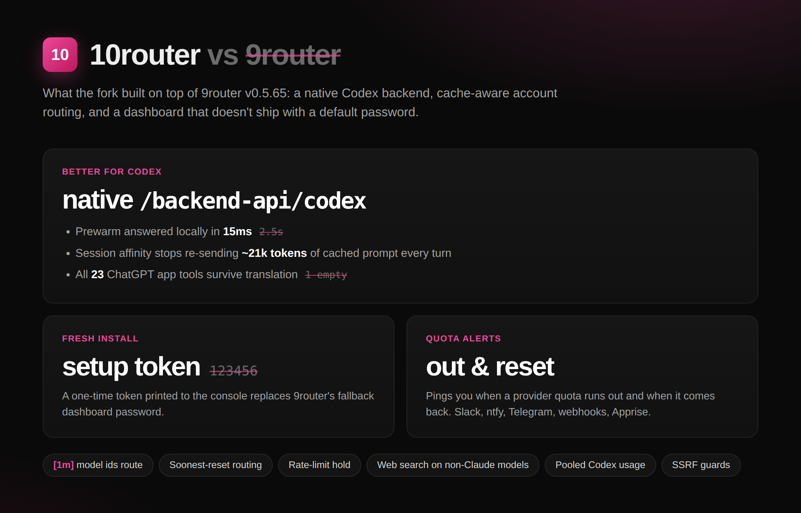

<div align="center">
  
</div>

# 10router

A local AI routing gateway with a web dashboard. It exposes one OpenAI-compatible
endpoint and routes requests across 40+ upstream providers, translating between
API formats and falling back across models and accounts.

[](https://www.npmjs.com/package/10router)
[](https://hub.docker.com/r/some-du6e/10router)
[](https://github.com/some-du6e/10router/blob/main/LICENSE)

## What it does

- **One endpoint** — point any OpenAI-compatible client at `http://localhost:20128/v1`.
- **Format translation** — translate OpenAI-compatible requests to provider-specific APIs and back.
- **Combo fallback** — define an ordered list of models; the router advances on quota exhaustion or error.
- **Multi-account** — several accounts per provider, round-robin or priority.
- **Credential management** — OAuth (PKCE) and API keys, with automatic token refresh.
- **Quota and usage tracking** — per provider and model, with reset countdowns.
- **Deployment** — designed for local use. Docker is available for self-hosting.

## What changed from 9router



- Codex connects natively at `/backend-api/codex`, over HTTP or WebSocket, as if 10router
  were ChatGPT's backend.
- Session affinity keeps a Codex conversation on one account, so it stops re-sending about
  21k tokens of cached prompt every turn.
- Tools from the ChatGPT app survive translation, and `[1m]` model ids route instead of
  returning 404.
- A fresh install prints a one-time setup token. 9router fell back to the password `123456`.

The full list is in [10router-vs-9router.md](10router-vs-9router.md).

## Compatibility

This is the short list of behavior existing clients and installs can rely on. It is a
practical promise, not a claim that upstream providers will never change their APIs.

### Client endpoints

- OpenAI-compatible clients use `http://localhost:20128/v1`.
- Chat clients call `POST /v1/chat/completions`.
- Anthropic-shaped clients call `POST /v1/messages`.
- Model discovery uses `GET /v1/models`.
- A key holder checks their own key's budget, spend and limits with `GET /v1/key`.
- Codex-native clients can use `http://localhost:20128/backend-api/codex`, including
  `/responses`, `/responses/compact`, and `/models`.

### Auth and models

- Send the dashboard API key as `Authorization: Bearer <key>`.
- Use provider-prefixed model IDs such as `cc/claude-opus-4-7` or `cx/gpt-5.5`.
- Combo names are accepted anywhere a model ID is accepted and preserve their ordered
  fallback behavior.
- A key can have a spend budget, a model allowlist and an expiry date (Endpoint page →
  API Keys). See [docs/API_KEY_BUDGETS.md](docs/API_KEY_BUDGETS.md).
- A management key (`10r-mgmt-…`) manages client keys or provider keys over
  `/api/management/v1`, limited to the providers, models and budget cap its scope allows.
  It never works on `/v1`. See [docs/MANAGEMENT_KEYS.md](docs/MANAGEMENT_KEYS.md).

## Request flow

```
client (Claude Code, Codex, Cursor, Cline, …)
  → http://localhost:20128/v1
  → 10router: format translation → account selection
  → upstream provider
  → SSE back to client
```

## Install

```bash
npm install -g 10router
10router
```

Dashboard: `http://localhost:20128/dashboard`. API: `http://localhost:20128/v1`.

### From source

```bash
cp .env.example .env
npm install
PORT=20128 NEXT_PUBLIC_BASE_URL=http://localhost:20128 npm run dev
```

To preview the dashboard with safe, fake provider data:

```bash
npm run dev:demo
```

This uses `.demo-data/` and the demo password `demo-password`; it never touches your normal `~/.9router` data.

Production:

```bash
npm run build
PORT=20128 HOSTNAME=0.0.0.0 NEXT_PUBLIC_BASE_URL=http://localhost:20128 npm run start
```

For client setup, see [CLIENT-CONFIGURATION.md](CLIENT-CONFIGURATION.md).

## Providers

**OAuth:** Claude Code, Antigravity, Codex, GitHub Copilot, Cursor, Kimchi, Kiro, Vertex AI.

**API key (40+):** OpenRouter, GLM, Kimi, MiniMax, OpenAI, Anthropic, Gemini, DeepSeek,
Groq, xAI, Mistral, Perplexity, Together, Fireworks, Cerebras, Cohere, NVIDIA, SiliconFlow,
Nebius, Chutes, Hyperbolic, plus custom OpenAI/Anthropic-compatible endpoints.

**No auth:** OpenCode Free (passthrough proxy, models auto-fetched from `opencode.ai/zen/v1/models`).

Discontinued upstream and no longer usable: iFlow free tier (2026), Qwen Code OAuth free
tier (2026-04-15), Gemini CLI (shut down 2026-06-18).

### Self-hosted providers

For speech and embeddings served from your own machine — whisper.cpp, faster-whisper,
Speaches, Kokoro-FastAPI, openedai-speech, llama.cpp/llama-server, vLLM, Infinity,
text-embeddings-inference, or anything speaking the OpenAI shape.

| Provider | Endpoint used | Typical server |
| --- | --- | --- |
| **Self-hosted STT** | `/v1/audio/transcriptions` | whisper.cpp, faster-whisper |
| **Self-hosted TTS** | `/v1/audio/speech` | Kokoro-FastAPI, openedai-speech |
| **Self-hosted Embedding** | `/v1/embeddings` | llama-server, vLLM, Infinity |

Every other speech provider is a named cloud service with a fixed endpoint. These three
read their address from **each connection**, so one provider can front several machines
and load-balance across them.

Set it on the connection as `providerSpecificData.baseUrl`:

| Provider | Give it | Result |
| --- | --- | --- |
| Self-hosted STT | the full URL — `http://host:8080/v1/audio/transcriptions` | used as-is |
| Self-hosted TTS | the server root — `http://host:8880` | `+ /v1/audio/speech` |
| Self-hosted Embedding | the **OpenAI base**, `/v1` included — `http://host:8080/v1` | `+ /embeddings` |

> **Mind the `/v1` on embeddings.** The adapter appends `/embeddings`, so
> `http://host:8080` resolves to `http://host:8080/embeddings` and misses the OpenAI
> route — llama-server answers **501**. Give it the same base URL an OpenAI client would
> use. A full `.../v1/embeddings` is also accepted.

The API key is not checked by most local servers, but the field must be non-empty: it is
what gives the connection a credentials record, and `baseUrl` lives there. Any placeholder
works.

Self-hosted Embedding has **no cloud fallback by design** — a connection saved without a
`baseUrl` is reported as a configuration error rather than quietly falling back to
`api.openai.com`, which would send your input text and API key to a third party under a
provider named "Self-hosted".

## Combos

A combo is a named, ordered list of models. The router tries them in order, advancing when
a model errors or its quota is exhausted.

```
Dashboard → Combos → Create New

Name: premium-coding
  1. cc/claude-opus-4-7
  2. glm/glm-5.1
  3. minimax/MiniMax-M2.7
```

Use the combo name in place of a model id in your client.

## Cost display

The "cost" in Usage Analytics is an estimate of what the same traffic would have cost on
paid APIs directly, from the pricing table. You pay providers directly, if at all; 10router
charges no one.

The same figure is what an API key's budget counts against: give a key a $2,000 budget and
it is refused once its requests add up to $2,000 at those prices. See
[docs/API_KEY_BUDGETS.md](docs/API_KEY_BUDGETS.md).

## Cloud sync

Syncs providers, combos, and settings across devices. In production, prefer the
server-side variables:

- `BASE_URL` — internal callback URL used by the sync scheduler.
- `CLOUD_URL` — cloud sync endpoint base.

`NEXT_PUBLIC_BASE_URL` and `NEXT_PUBLIC_CLOUD_URL` still work for compatibility and the UI,
but the server runtime prioritizes `BASE_URL`/`CLOUD_URL`. Sync requests time out and fail
fast so the UI doesn't hang when cloud DNS or network is unavailable.

## Deployment

10router is intended to run on the same machine as the clients using it. Avoid exposing
it from a datacenter or VPS IP: subscription providers may treat that traffic as token
resale or abuse and suspend the account.

### Docker

Published multi-platform images (`linux/amd64` + `linux/arm64`):

- Docker Hub: [`some-du6e/10router`](https://hub.docker.com/r/some-du6e/10router)
- GHCR: [`ghcr.io/some-du6e/10router`](https://github.com/some-du6e/10router/pkgs/container/10router)

```bash
docker run -d \
  --name 10router \
  -p 20128:20128 \
  -v "$HOME/.9router:/app/data" \
  -e DATA_DIR=/app/data \
  some-du6e/10router:latest
```

Build from source:

```bash
git clone https://github.com/some-du6e/10router.git
cd 10router/app
docker build -t 10router .
docker run -d --name 10router -p 20128:20128 \
  -v "$HOME/.9router:/app/data" -e DATA_DIR=/app/data 10router
```

Container defaults: `PORT=20128`, `HOSTNAME=0.0.0.0`.

#### Restarts and deploys

On `SIGTERM` or `SIGINT` (`docker stop` sends `SIGTERM`) the server drains before it exits:

- It closes its listening socket, so **new connections are refused for the whole drain**.
  On a setup that stops the old container before starting the new one, that's the trade-off:
  turns already running finish, and new requests fail until the new instance is up. So each
  deploy's outage now lasts as long as the drain runs: up to 3 minutes by default once the
  stop grace period is raised (below), and up to the grace period itself before that.
- Model requests already running get up to `SHUTDOWN_DRAIN_TIMEOUT_MS` (3 minutes by default)
  to finish, long streams included. That covers `/v1*`, `/api/v1*`, `/v1beta*`, `/api/v1beta*`,
  `/responses`, `/systemone`, `/codex/*`, `/backend-api/codex/*` and Codex WebSocket turns.
  Then the app's own shutdown work runs (database flush and close) and it exits. A request
  held at a provider limit keeps the drain open until that timeout.
- A request sent on a keep-alive connection that was already open gets a `503` with
  `Retry-After: 5` and `Connection: close`. A Codex turn started during the drain fails; Codex's
  retry works once a server is accepting again. Dashboard streams that never end (usage,
  console logs, MCP) are closed at the start, so an open dashboard tab may need a reload after
  the restart.
- A repeat signal within 1.5 seconds of the first is ignored (`npm run start` forwards the one
  it got); a later one exits at once. `SHUTDOWN_DRAIN_TIMEOUT_MS=0` turns the drain off.
- It needs Node (the Docker image and `npm run start`). Under Bun (`start:bun`) a signal still
  exits at once.

**The drain does nothing unless whatever stops the process waits for it.** Docker kills the
process 10 seconds after `docker stop` by default, which cuts the drain short and can kill the
shutdown work after it. Set the stop timeout **longer** than the drain timeout, e.g. drain +
30 seconds:

- `docker stop -t 210 10router` (or `docker run --stop-timeout 210 …`)
- Compose: `stop_grace_period: 3m30s` (the repo's `docker-compose.yml` sets it)
- A hosting platform: its container stop timeout / grace period setting.
- PM2: `kill_timeout` (default 1.6 seconds), e.g. `pm2 start npm --name 10router --kill-timeout 210000 -- start`.
- systemd: `TimeoutStopSec=210` in the unit.

A kill that comes too early loses about the last 5 seconds of buffered request-detail rows
and, on the sql.js driver, about 100 ms of writes. SQLite itself replays its WAL on the next
open.

`GET /api/health` answers `200` while the server is up, with no auth, for a platform health
check. During the drain new connections are refused, so a health check fails then.

Don't overlap a restart by running two instances side by side on one `DATA_DIR`. SQLite and
sql.js writes are last-writer-wins, and OAuth refresh tokens rotate, so each instance would
overwrite or invalidate the other's state.

Data persists at `$HOME/.9router/db/data.sqlite` on the host (the `.9router` directory name
is retained for compatibility with existing installs) ↔ `/app/data/db/data.sqlite` in the
container.

### Environment variables

| Variable | Default | Description |
| --- | --- | --- |
| `JWT_SECRET` | Auto-generated (`$DATA_DIR/jwt-secret`, `~/.9router` by default) | Signs the dashboard session cookie and the SAML `saml_state` cookie; set the same value on every instance behind one URL (each instance still refuses a request it already used). Values shorter than 32 characters and documented placeholders are ignored with a warning, and the generated file is used instead; generate one with `openssl rand -hex 32`. Logout and password changes end sessions through the database, so instances that each have their own database revoke only their own sessions; behind one URL they need a shared database for that to apply everywhere |
| `INITIAL_PASSWORD` | unset | Optional headless bootstrap password (min 8 chars). When unset, first run requires the one-time setup token printed to the server console. There is no default password |
| `SSO_ALLOWED_USERS` | unset (any IdP account) | Optional OIDC/SAML dashboard allowlist: comma-separated emails, `@domain` suffixes or IdP subject IDs (OIDC `sub`, SAML NameID). Unset, every account the IdP signs in gets admin access. For OIDC, email entries only match an email the IdP marks verified (`email_verified`; Entra ID often omits it, so list Entra users by subject ID). For SAML, an email entry trusts the email the IdP asserts, so if users can register or change their email at the IdP, list them by NameID |
| `DATA_DIR` | `~/.9router` | App data location (SQLite at `$DATA_DIR/db/data.sqlite`); the `.9router` name is kept for compatibility |
| `PORT` | framework default | Service port (`20128` in examples) |
| `HOSTNAME` | framework default | Bind host (Docker defaults to `0.0.0.0`) |
| `NODE_ENV` | runtime default | Set `production` for deploy |
| `SHUTDOWN_DRAIN_TIMEOUT_MS` | `180000` | On SIGTERM/SIGINT, how long in-flight model requests get to finish before exit (new connections are refused meanwhile); `0`/`off`/`false` exits at once. Set the container stop grace period longer than this |
| `BASE_URL` | `http://localhost:20128` | Server-side internal base URL used by cloud sync jobs |
| `CLOUD_URL` | `https://9router.com` | Server-side cloud sync endpoint base URL |
| `NEXT_PUBLIC_BASE_URL` | `http://localhost:3000` | Backward-compatible/public base URL (prefer `BASE_URL`) |
| `NEXT_PUBLIC_CLOUD_URL` | `https://9router.com` | Backward-compatible/public cloud URL (prefer `CLOUD_URL`) |
| `NEXT_PUBLIC_GA_ID` | unset (no analytics) | Optional Google Analytics 4 measurement ID (`G-...`) for the dashboard; never loaded on `/callback`. Baked in by `next build`, so a running server ignores it (Docker: `--build-arg NEXT_PUBLIC_GA_ID=...`) |
| `API_KEY_SECRET` | `endpoint-proxy-api-key-secret` | HMAC secret for generated API keys |
| `MACHINE_ID_SALT` | `endpoint-proxy-salt` | Salt for stable machine ID hashing |
| `ENABLE_REQUEST_LOGS` | `false` | Enables request/response logs under `logs/` |
| `AUTH_COOKIE_SECURE` | `false` | Force `Secure` auth cookie (set `true` behind an HTTPS reverse proxy) |
| `REQUIRE_API_KEY` | `false` | Enforce Bearer API key on `/v1/*` (recommended for internet-exposed deploys) |
| `HTTP_PROXY`, `HTTPS_PROXY`, `ALL_PROXY`, `NO_PROXY` | empty | Outbound proxy for upstream provider calls |
| `SEARXNG_URL` | `http://localhost:8888/search` | Endpoint for the built-in unauthenticated SearXNG web-search provider. Must resolve to a public address (the SSRF guard blocks private hosts). Claude Code's WebSearch only falls back to SearXNG when this is set. |
| `DETECT_ANTHROPIC_FIRST_HINTS` | empty | URL substrings that make Add endpoint probe Anthropic Messages first. Comma-separated, any case; quotes around entries are ignored. URLs naming Anthropic or Claude and `sk-ant-` keys already do. A hint matches anywhere in the endpoint URL (scheme, host, path, query; a trailing API path like `/chat/completions` is cut off first), so use a distinctive piece of the host. Restart after changing it. |

Notes:

- Lowercase proxy variables also work: `http_proxy`, `https_proxy`, `all_proxy`, `no_proxy`.
- `.env` is not baked into the Docker image (`.dockerignore`) — inject runtime config with
  `--env-file` or `-e`.
- On Windows, `APPDATA` can be used for local storage path resolution.
- `INSTANCE_NAME` appears in older docs and env templates but is not used at runtime.

### Runtime files

- App state: `${DATA_DIR}/db/data.sqlite` (providers, combos, aliases, keys, settings, usage history)
- Auto backups: `${DATA_DIR}/db/backups/`
- Request/translator logs: `<repo>/logs/...` when `ENABLE_REQUEST_LOGS=true`. Credential headers are masked to their last 4 characters and secret query params (`key`, `api_key`, `apikey`, `access_token`, `token`, ...) are redacted
- Owner-only: `${DATA_DIR}/db/` and `backups/` are `0700`, `data.sqlite` (with `-wal`/`-shm`) and any leftover `db.json`/`usage.json`/`request-details.json` are `0600`, and `logs/` is `0700` with `0600` files. A backup job or sidecar running as another OS user can no longer read them; run it as the same user. A `DATA_DIR` you created yourself keeps its own mode
- In Docker, `${DATA_DIR}` and `~/.9router` resolve to the same location — the symlink
  `/root/.9router -> /app/data` is created at build time.

## Models

<details>
<summary><b>Model ids by provider prefix</b></summary>

**Claude Code (`cc/`)**

- `cc/claude-opus-4-7`
- `cc/claude-opus-4-6`
- `cc/claude-sonnet-4-6`
- `cc/claude-sonnet-4-5-20250929`
- `cc/claude-haiku-4-5-20251001`

**Codex (`cx/`)**

- `cx/gpt-5.5`
- `cx/gpt-5.4`
- `cx/gpt-5.3-codex`
- `cx/gpt-5.2-codex`
- `cx/gpt-5.1-codex-max`

**GitHub Copilot (`gh/`)**

- `gh/gpt-5.4`
- `gh/claude-opus-4.7`
- `gh/claude-sonnet-4.6`
- `gh/gemini-3.1-pro-preview`
- `gh/grok-code-fast-1`

**Cursor (`cu/`)**

- `cu/claude-4.6-opus-max`
- `cu/claude-4.5-sonnet-thinking`
- `cu/gpt-5.3-codex`
- `cu/kimi-k2.5`

**GLM (`glm/`)**

- `glm/glm-5.1`
- `glm/glm-5`
- `glm/glm-4.7`

**MiniMax (`minimax/`)**

- `minimax/MiniMax-M2.7`
- `minimax/MiniMax-M2.5`

**Kimi (`kimi/`)**

- `kimi/kimi-k2.5`
- `kimi/kimi-k2.5-thinking`

**Kiro (`kr/`)**

- `kr/claude-sonnet-4.5`
- `kr/claude-haiku-4.5`
- `kr/glm-5`
- `kr/MiniMax-M2.5`
- `kr/qwen3-coder-next`
- `kr/deepseek-3.2`

**OpenCode (`oc/`)**

- Auto-fetched from `opencode.ai/zen/v1/models`

**Vertex AI (`vertex/`)**

- `vertex/gemini-3.1-pro-preview`
- `vertex/gemini-3-flash-preview`
- `vertex/gemini-2.5-flash`
- `vertex-partner/glm-5-maas`
- `vertex-partner/deepseek-v3.2-maas`
- `vertex-partner/qwen3-next-80b-a3b-thinking-maas`

</details>

## API

### Chat completions

```bash
POST http://localhost:20128/v1/chat/completions
Authorization: Bearer your-api-key
Content-Type: application/json

{
  "model": "cc/claude-opus-4-6",
  "messages": [{"role": "user", "content": "Write a function to..."}],
  "stream": true
}
```

### List models

```bash
GET http://localhost:20128/v1/models
Authorization: Bearer your-api-key
```

Returns all models and combos in OpenAI format. A key with a model allowlist sees only
the models it may use.

### Your key's budget and spend

```bash
GET http://localhost:20128/v1/key
Authorization: Bearer your-api-key
```

Returns the calling key's own budget (`limit`), spend (`usage`), what's left
(`limit_remaining`), allowed models and expiry, and nothing about other keys. See
[docs/API_KEY_BUDGETS.md](docs/API_KEY_BUDGETS.md).

### Management API

```bash
GET  http://localhost:20128/api/management/v1/me
GET  http://localhost:20128/api/management/v1/client-keys
POST http://localhost:20128/api/management/v1/client-keys     {"name", "allowedModels", "budgetUsd", "expiresAt"}
POST http://localhost:20128/api/management/v1/provider-keys   {"provider", "apiKey", "name", "baseUrl"}
Authorization: Bearer 10r-mgmt-...
```

Create a management key on the Endpoint page and pick what it may do: client keys
(optionally only for some providers or models, under a budget cap) and/or provider keys
(optionally only for some providers). For an upstream where each key has its own host,
the dashboard can also list, per custom endpoint, the hosts a key it adds may use for its
own `baseUrl` (`*.acme.example`, https only). By default it sees and deletes only the keys it
created. Responses never include provider secrets, and a new client key's full value
appears only in the response that created it. Management keys can't be created or listed
through this API. See [docs/MANAGEMENT_KEYS.md](docs/MANAGEMENT_KEYS.md).

## Troubleshooting

**"Language model did not provide messages"** — provider quota exhausted. Check the
dashboard quota tracker; add a combo fallback.

**Rate limiting** — subscription quota out. Add a combo, e.g.
`cc/claude-opus-4-7 → glm/glm-5.1 → kr/claude-sonnet-4.5`.

**OAuth token expired** — refreshed automatically. If it persists: Dashboard → Provider → Reconnect.

**Dashboard opens on the wrong port** — set `PORT=20128` and
`NEXT_PUBLIC_BASE_URL=http://localhost:20128`.

**First login fails** — a fresh install has no default password. Open `/setup` and paste the one-time setup token printed to the server console (valid 5 minutes; restart to get a new one). Lost it? `10router` CLI → **Settings** → **Reset Password**.

**No logs under `logs/`** — set `ENABLE_REQUEST_LOGS=true`.

## Tech stack

- Node.js 20+
- Next.js 16, React 19, Tailwind CSS 4
- SQLite (`bun:sqlite` → `better-sqlite3` → `node:sqlite` → `sql.js` fallback chain)
- Server-Sent Events
- OAuth 2.0 (PKCE) + JWT + API keys

## Acknowledgments

- **[CLIProxyAPI](https://github.com/router-for-me/CLIProxyAPI)** — the original Go
  implementation this JavaScript port was based on.

## License

MIT — see [LICENSE](LICENSE).
