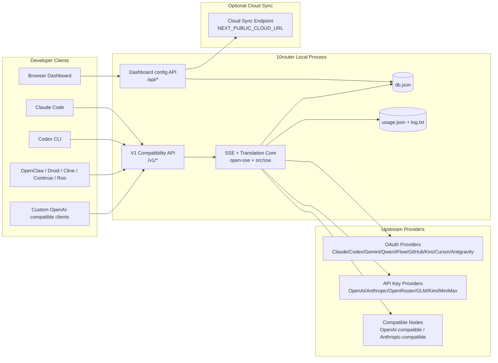
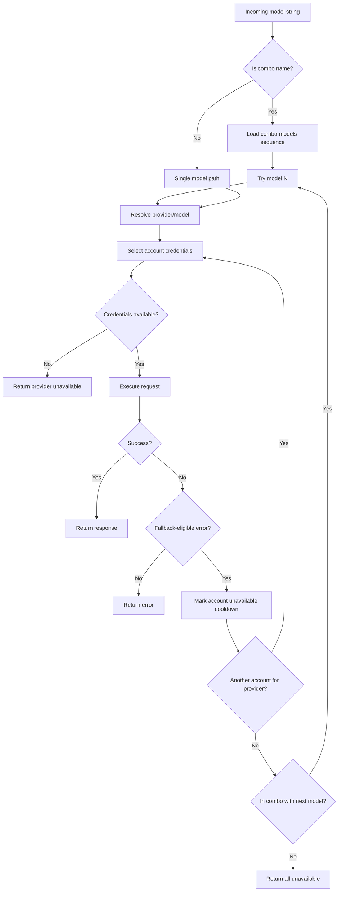
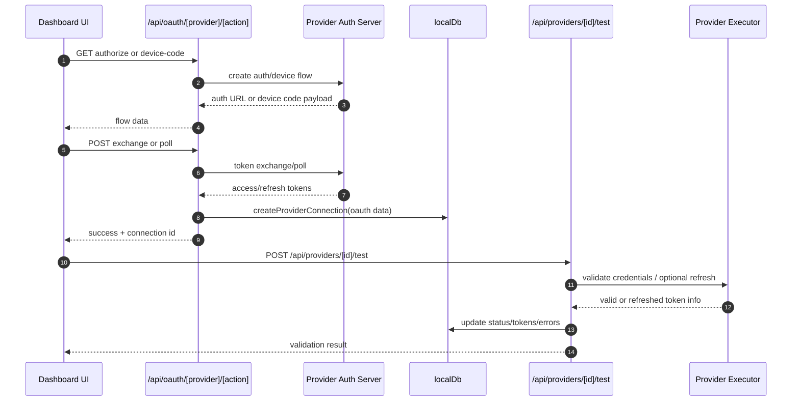
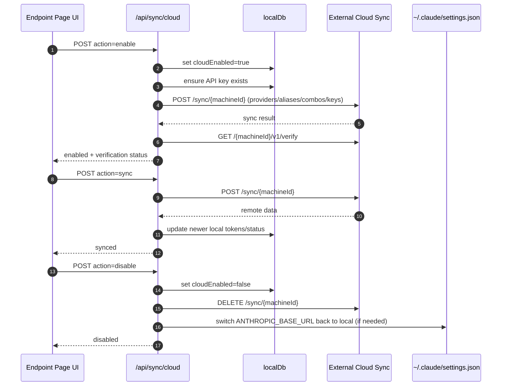
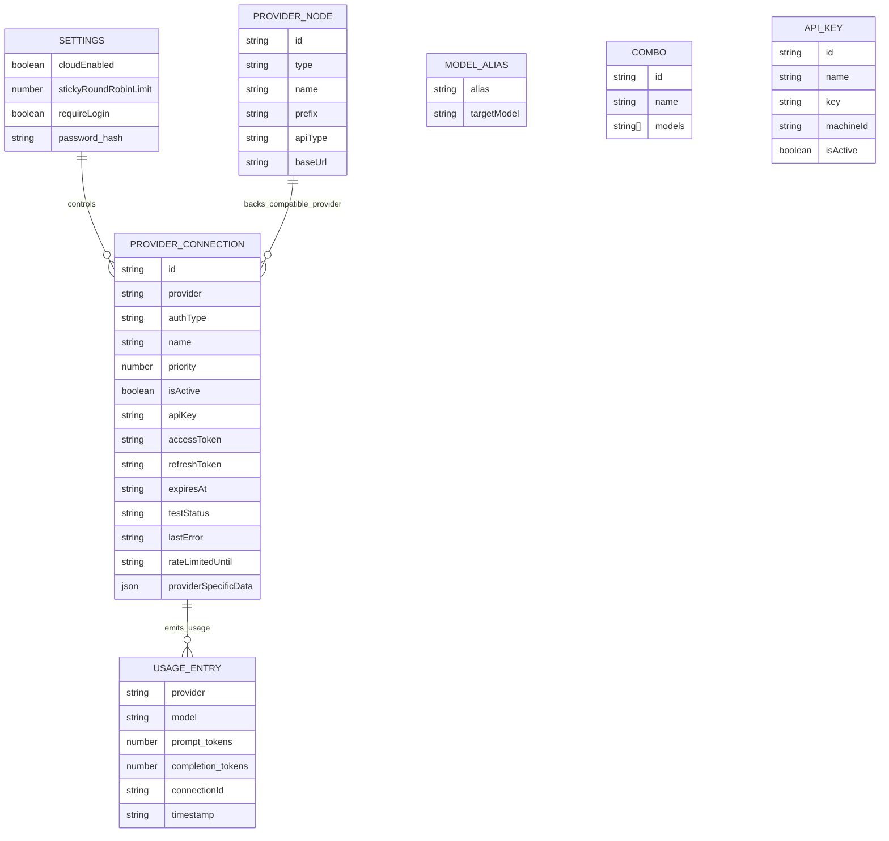
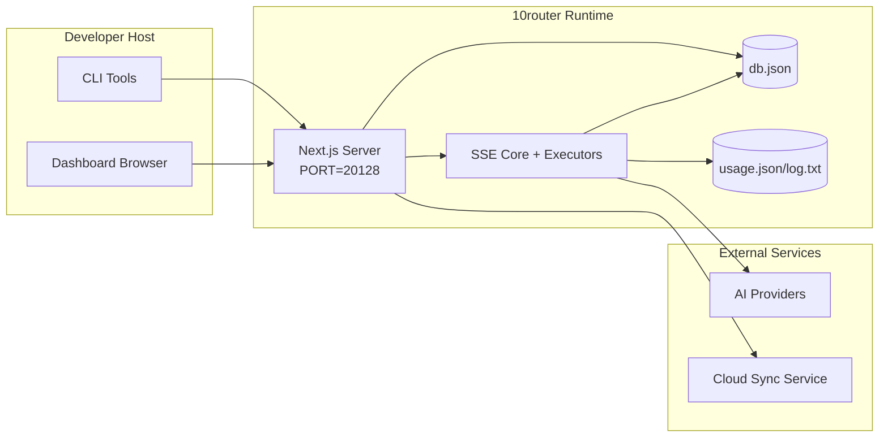

# 10router Architecture

_Last updated: 2026-02-06_

## Executive Summary

10router is a local AI routing gateway and dashboard built on Next.js.
It provides a single OpenAI-compatible endpoint (`/v1/*`) and routes traffic across multiple upstream providers with translation, fallback, token refresh, and usage tracking.

Core capabilities:

- OpenAI-compatible API surface for CLI/tools
- Request/response translation across provider formats
- Model combo fallback (multi-model sequence)
- Account-level fallback (multi-account per provider)
- OAuth + API-key provider connection management
- Local persistence for providers, keys, aliases, combos, settings, pricing
- Usage/cost tracking and request logging
- Optional cloud sync for multi-device/state sync

Primary runtime model:

- Next.js app routes under `src/app/api/*` implement both dashboard APIs and compatibility APIs
- A shared SSE/routing core in `src/sse/*` + `open-sse/*` handles provider execution, translation, streaming, fallback, and usage

## Scope and Boundaries

### In Scope

- Local gateway runtime
- Dashboard configuration APIs (`/api/*`, behind the session login)
- The scoped management-key API (`/api/management/v1/*`, bearer management keys)
- Provider authentication and token refresh
- Request translation and SSE streaming
- Local state + usage persistence
- Optional cloud sync orchestration

### Out of Scope

- Cloud service implementation behind `NEXT_PUBLIC_CLOUD_URL`
- Provider SLA/control plane outside local process
- External CLI binaries themselves (Claude CLI, Codex CLI, etc.)

## High-Level System Context



## Core Runtime Components

## 1) API and Routing Layer (Next.js App Routes)

Main directories:

- `src/app/api/v1/*` and `src/app/api/v1beta/*` for compatibility APIs
- `src/app/api/*` for the dashboard's configuration APIs (session login)
- `src/app/api/management/v1/*` for the management-key API: scoped
  `10r-mgmt-…` bearer keys that list, create and delete client keys and
  provider keys (see `docs/MANAGEMENT_KEYS.md`). Not the same thing as the
  dashboard's configuration APIs above, which a management key can't reach.
- Next rewrites in `next.config.mjs` map `/v1/*` to `/api/v1/*`, and
  `/backend-api/codex/*` (plus the duplicated `/backend-api/codex/v1/*` some
  clients emit) to `/api/v1/codex/*` — the Codex-native ingress

Important compatibility routes:

- `src/app/api/v1/chat/completions/route.js`
- `src/app/api/v1/messages/route.js`
- `src/app/api/v1/responses/route.js`
- `src/app/api/v1/models/route.js`
- `src/app/api/v1/codex/*` — Codex-native ingress served at `/backend-api/codex`
  (`responses` and `responses/compact` reuse the `/v1` handlers, `[...path]`
  acknowledges Codex's advisory side-calls). `models` serves the routed models in
  Codex's `{ "models": [...] }` shape (`src/lib/codex/modelCatalog.js`), which
  replaces Codex's own catalog once it decodes. A routed model that Codex's own
  lookup matches to a model in Codex's bundled catalog (vendored in
  `open-sse/config/codex/`, refreshed with `scripts/vendor-codex-catalog.mjs`),
  such as `cx/gpt-5.5` or `gh/gpt-5.5`, gets that entry under its routed id.
  Any other model gets a generic entry with Codex's generic prompt and, if it
  can call tools, a shell and the freeform `apply_patch` tool. Codex's bundled
  models also stay in under their bare names, hidden from the picker. The same
  body carries an OpenAI-shaped `data` list.
- `src/app/api/v1/messages/count_tokens/route.js`
- `src/app/api/v1/key/route.js` — `GET /v1/key`: the calling key's own budget,
  spend, allowed models and expiry (see `docs/API_KEY_BUDGETS.md`)
- `src/app/api/v1beta/models/route.js`
- `src/app/api/v1beta/models/[...path]/route.js`

Management domains:

- Auth/settings: `src/app/api/auth/*`, `src/app/api/settings/*`
- Management keys: `src/app/api/management-keys/*` (dashboard side, session
  checked in the route too) and `src/app/api/management/v1/*` (the keys' own
  API). In `src/dashboardGuard.js`, `/api/management/v1/*` is the only path
  that takes a management key, as `Authorization: Bearer`, and nothing else; a
  token carrying `10r-mgmt-` is refused on every inference prefix, loopback included.
- Providers/connections: `src/app/api/providers*`
- Provider nodes: `src/app/api/provider-nodes*`
- OAuth: `src/app/api/oauth/*`
- Keys/aliases/combos/pricing: `src/app/api/keys*`, `src/app/api/models/alias`, `src/app/api/combos*`, `src/app/api/pricing`
- Usage: `src/app/api/usage/*`
- Sync/cloud: `src/app/api/sync/*`, `src/app/api/cloud/*`
- CLI tooling helpers: `src/app/api/cli-tools/*`

## 2) SSE + Translation Core

Main flow modules:

- Entry: `src/sse/handlers/chat.js`
- Core orchestration: `open-sse/handlers/chatCore.js`
- Provider execution adapters: `open-sse/executors/*`
- Format detection/provider config: `open-sse/services/provider.js`
- Model parse/resolve: `src/sse/services/model.js`, `open-sse/services/model.js`
- Account fallback logic: `open-sse/services/accountFallback.js`
- Translation registry: `open-sse/translator/index.ts`
- Stream transformations: `open-sse/utils/stream.js`, `open-sse/utils/streamHandler.js`
- Usage extraction/normalization: `open-sse/utils/usageTracking.js`

## 3) Persistence Layer

Primary state DB:

- `src/lib/localDb.js`
- file: `${DATA_DIR}/db.json` (or `~/.9router/db.json` when `DATA_DIR` is unset) (the directory name is unchanged from the previous release for backward compatibility)
- entities: providerConnections, providerNodes, modelAliases, combos, apiKeys, settings, pricing

Usage DB:

- `src/lib/usageDb.js`
- files: `~/.9router/usage.json`, `~/.9router/log.txt`
- note: currently independent from `DATA_DIR`

## 4) Auth + Security Surfaces

- Dashboard cookie auth: `src/proxy.js`, `src/app/api/auth/login/route.js`
- API key generation/verification: `src/shared/utils/apiKey.js`
- Client API key limits (budget, model allowlist, expiry), checked by every
  `/v1` handler before any upstream call: `src/sse/services/keyLimits.js`.
  Spend is a running total per key, updated with each usage row
  (`docs/API_KEY_BUDGETS.md`)
- Provider secrets persisted in `providerConnections` entries
- Optional proxy support for upstream calls via env proxy variables (`open-sse/utils/proxyFetch.js`)

## 5) Cloud Sync

- Scheduler init: `src/lib/initCloudSync.js`, `src/shared/services/initializeCloudSync.js`
- Periodic task: `src/shared/services/cloudSyncScheduler.js`
- Control route: `src/app/api/sync/cloud/route.js`

## Request Lifecycle (`/v1/chat/completions`)

```mermaid
sequenceDiagram
    autonumber
    participant Client as CLI/SDK Client
    participant Route as /api/v1/chat/completions
    participant Chat as src/sse/handlers/chat
    participant Core as open-sse/handlers/chatCore
    participant Model as Model Resolver
    participant Auth as Credential Selector
    participant Exec as Provider Executor
    participant Prov as Upstream Provider
    participant Stream as Stream Translator
    participant Usage as usageDb

    Client->>Route: POST /v1/chat/completions
    Route->>Chat: handleChat(request)
    Chat->>Chat: API key check, then the key's limits (budget, model allowlist, expiry; keyLimits.js)
    Chat->>Model: parse/resolve model or combo

    alt Combo model
        Chat->>Chat: iterate combo models (handleComboChat)
    end

    Chat->>Auth: getProviderCredentials(provider)
    Auth-->>Chat: active account + tokens/api key

    Chat->>Core: handleChatCore(body, modelInfo, credentials)
    Core->>Core: detect source format
    Core->>Core: translate request to target format
    Core->>Exec: execute(provider, transformedBody)
    Exec->>Prov: upstream API call
    Prov-->>Exec: SSE/JSON response
    Exec-->>Core: response + metadata

    alt 401/403
        Core->>Exec: refreshCredentials()
        Exec-->>Core: updated tokens
        Core->>Exec: retry request
    end

    Core->>Stream: translate/normalize stream to client format
    Stream-->>Client: SSE chunks / JSON response

    Stream->>Usage: extract usage + persist history/log
```

## Combo + Account Fallback Flow



Fallback decisions are driven by `open-sse/services/accountFallback.js` using status codes and error-message heuristics.

On a custom (OpenAI-/Anthropic-compatible) endpoint, a request error every key would refuse ends the account walk early: once `SAME_REQUEST_ERROR_STOP_AFTER` (2) accounts of one model answered a request with the same request error (the upstream's message, read out of a JSON body when there is one, compared lowercased, digits as `#`, whitespace collapsed; `open-sse/services/sameRequestError.ts`), the account loop in `src/sse/handlers/chat.ts` returns that error instead of trying the next account. A combo then moves on to its next model as for any final failure. It's an allowlist: only a 413, or a 400/422 whose message matches `SAME_REQUEST_ERROR_PATTERNS` in `open-sse/config/errorConfig.js` (the context window or the model's token limit, a rejected tool schema, a thinking budget), counts. Any other 4xx may be about the account (these keys aren't locked for it), so it keeps the walk. So do 401/403/404/429, 5xx and header timeouts, and so does a message or body that names a bad key, billing, a rate or usage limit or quota, a limit on one key, account, organization or plan (`SAME_REQUEST_ERROR_KEY_LIMIT`: per minute or day, TPM, daily, tier, upgrade, "your organization", "your subscription", ...), or a refusal of one model or operation. Keys that reach one upstream the same way (same proxy or relay, or none) are assumed to be on the same tier, so their messages need only match up to numbers. When any active key has its own base URL, the keys' upstream fields differ, or they go through different proxies or relays (`keysShareOneUpstream` in `src/sse/services/auth.js`, using `networkPath`'s transport), their limits may differ: a proxy or relay has its own body limit and can answer a 413 itself. There at least `max(SAME_REQUEST_ERROR_STOP_AFTER, 2)` distinct upstreams (`src/sse/services/connectionUpstream.ts`, which `auth.js` uses too; a base URL compared canonically: scheme and host lowercased, a default port dropped, trailing slashes and a pasted `/chat/completions`, `/messages` or `/responses` dropped, path case and query string kept; dead-key evidence uses the same comparison) must give the very same message, numbers included: the extracted upstream message, only trimmed, lowercased and stripped of a relay's request id. That message must be a context or token limit (`SAME_REQUEST_ERROR_LIMIT_PATTERNS`) naming both sizes, two runs of 4+ digits such as "12345 tokens > 10000 maximum", and never a 413. So "> 200000 maximum" from one and "> 1000000 maximum" from another keeps the walk, and so do two keys on one upstream while a third key is elsewhere, a schema error with a tool index, and a message whose only digits are a model name. `SAME_REQUEST_ERROR_STOP_AFTER=1` stops at the first error only when the keys share one upstream reached the same way (same proxy or relay). A pool that mixes tiers behind one URL needs `SAME_REQUEST_ERROR_STOP_AFTER=0`, which is global: it turns the stop off for every node. A 413 counts whatever it says but goes through the same vetoes, and a relay's "(request id: ...)" in the message is dropped before comparing. Built-in providers keep walking every key, since their accounts can differ in plan or region.

Prompt-cache affinity (`open-sse/services/cacheAffinity.js`) shapes step G for requests that ask for a prompt cache. Upstream caches are per account, so each conversation remembers its warm keys: the ones that served it within the cache TTL. A conversation is identified by a hash of the client key, session id, system prompt, instructions and first message. In `getProviderCredentials`, fill-first and soonest-reset keep their own pick, so a better usable key is never skipped. Fill-first ranks by priority. Soonest-reset ranks by reset, then priority; a known reset ranks ahead of an unknown one, and two unknown resets fall to priority. Round-robin takes the conversation's most recently used usable warm key and doesn't update the rotation for it. When the pick isn't warm and the prompt is large (`CACHE_AFFINITY_MIN_TOKENS`), it goes through the servable warm keys that are only limit-locked, soonest lock end first. Each one's retry time is lock end + `lockSlackMs` + jitter (one draw per selection). It returns `warmRetryAtMs` for the first one whose earliest retry, lock end + `lockSlackMs`, fits the remaining `CACHE_AFFINITY_MAX_WAIT_MS` (counted per request and model). It skips a candidate when a servable key the strategy ranks ahead of it is usable or frees up (lock or quota block over) within another `lockSlackMs` of that earliest retry. The jitter is then cut to the budget, and to `lockSlackMs` before the first better-ranked key frees up. The same margin on both sides absorbs late timers and the time selection takes before it reads the locks. Round-robin ranks none, so nothing overtakes there. The account loop in `src/sse/handlers/chat.ts` then sleeps until that time (abort-aware) and selects again. A warm key's own short 429 is recorded as a failure but not excluded, so the next selection can wait for it. Codex uses its own opt-in session pin (`open-sse/services/sessionAffinity.js`) instead.

## OAuth Onboarding and Token Refresh Lifecycle



Refresh during live traffic runs inside the chat, image, embeddings and video cores (`open-sse/handlers/chatCore.js`, `imageGenerationCore.js`, `embeddingsCore.js`, `videoCore.js`), through the executor's `refreshCredentials()` (video calls `refreshTokenByProvider()`), and each applies the result to the request's copy with `applyRefreshedCredentials()`. Those refreshes, the proactive one in `checkAndRefreshToken()`, usage polling, the connection test (with its `refreshTokenUsed` check), model listing and the translator's send all save through `updateProviderCredentials()` (`src/sse/services/credentialSave.js`). It writes only the fields the result carries: `updateProviderConnection()` applies the result's `providerSpecificData` over the stored row and stamps `lastRefreshAt` when the access token changed, in one transaction.

## Cloud Sync Lifecycle (Enable / Sync / Disable)



Periodic sync is triggered by `CloudSyncScheduler` when cloud is enabled.

## Data Model and Storage Map



Physical storage files:

- main state: `${DATA_DIR}/db.json` (or `~/.9router/db.json`)
- usage stats: `~/.9router/usage.json`
- request log lines: `~/.9router/log.txt`
- optional translator/request debug sessions: `<repo>/logs/...`

## Deployment Topology



Restarts: on SIGTERM/SIGINT `custom-server.js` drains (`server-drain.js`). It closes the listening socket, so new connections are refused for the whole drain, and waits up to `SHUTDOWN_DRAIN_TIMEOUT_MS` for in-flight model requests before running the app's own shutdown listeners and exiting. It only helps if the container's stop grace period is longer than that timeout. Never run two instances on one `DATA_DIR` to overlap a restart: SQLite / sql.js writes are last-writer-wins, and rotating OAuth refresh tokens would be lost.

## Module Mapping (Decision-Critical)

### Route and API Modules

- `src/app/api/v1/*`, `src/app/api/v1beta/*`: compatibility APIs
- `src/app/api/providers*`: provider CRUD, validation, testing
- `src/app/api/provider-nodes*`: custom compatible node management
- `src/app/api/oauth/*`: OAuth/device-code flows
- `src/app/api/keys*`: local API key lifecycle
- `src/app/api/models/alias`: alias management
- `src/app/api/combos*`: fallback combo management
- `src/app/api/pricing`: pricing overrides for cost calculation
- `src/app/api/usage/*`: usage and logs APIs
- `src/app/api/sync/*` + `src/app/api/cloud/*`: cloud sync and cloud-facing helpers
- `src/app/api/cli-tools/*`: local CLI config writers/checkers

### Routing and Execution Core

- `src/sse/handlers/chat.js`: request parse, combo handling, account selection loop
- `open-sse/handlers/chatCore.js`: translation, executor dispatch, retry/refresh handling, stream setup
- `open-sse/executors/*`: provider-specific network and format behavior

### Translation Registry and Format Converters

- `open-sse/translator/index.ts`: translator registry and orchestration
- Request translators: `open-sse/translator/request/*`
- Response translators: `open-sse/translator/response/*`
- Format constants: `open-sse/translator/formats.js`

### Persistence

- `src/lib/localDb.js`: persistent config/state
- `src/lib/usageDb.js`: usage history and rolling request logs

## Provider Executor Coverage

Specialized executors:

- `antigravity`
- `gemini-cli`
- `github`
- `kiro`
- `codex`
- `cursor`

Default executor path:

- all other providers (including compatible node providers) use `open-sse/executors/default.js`

## Format Translation Coverage

Detected source formats include:

- `openai`
- `openai-responses`
- `claude`
- `gemini`

Target formats include:

- OpenAI chat/Responses
- Claude
- Gemini/Gemini-CLI/Antigravity envelope
- Kiro
- Cursor

Translations are selected dynamically based on source payload shape and provider target format.

## Failure Modes and Resilience

## 1) Account/Provider Availability

- provider account cooldown on transient/rate/auth errors
- account fallback before failing request
- combo model fallback when current model/provider path is exhausted
- an upstream that sends no response headers in time fails as a 504 (`HEADERS_TIMEOUT` in `open-sse/config/errorConfig.js`): one request tries at most one more key after it, and streaming header timeouts from two requests on two keys of one provider/model, with no success between, mark that model hung (`open-sse/services/modelHang.js`, in memory per process), so new requests for it fail at once (a 504 with Retry-After) until a single probe request, sent to keys that haven't stalled, gets an answer; the request that marks it, if it already sent a stream's early headers, ends with a retryable in-stream error instead
- on a custom (OpenAI-/Anthropic-compatible) endpoint, a request error that `SAME_REQUEST_ERROR_STOP_AFTER` (2) keys of one model answered with the same message is returned at once instead of trying the remaining keys (`open-sse/services/sameRequestError.ts`); only a 413, or a 400/422 whose message matches `SAME_REQUEST_ERROR_PATTERNS` (context or token overflow, a rejected tool schema, a thinking budget), counts, and none whose text names a limit on the key, organization or plan (a 413 included); when the keys don't all reach one upstream, at least `max(SAME_REQUEST_ERROR_STOP_AFTER, 2)` distinct upstreams must give the very same context or token limit message naming both sizes (never a 413); built-in providers keep walking every key; for a pool mixing tiers behind one URL set `SAME_REQUEST_ERROR_STOP_AFTER=0`, which turns the stop off for every node

## 2) Token Expiry

- pre-check and refresh with retry for refreshable providers
- 401/403 retry after refresh attempt in core path

## 3) Stream Safety

- disconnect-aware stream controller
- translation stream with end-of-stream flush and `[DONE]` handling
- usage estimation fallback when provider usage metadata is missing

## 4) Cloud Sync Degradation

- sync errors are surfaced but local runtime continues
- scheduler has retry-capable logic, but periodic execution currently calls single-attempt sync by default

## 5) Data Integrity

- DB shape migration/repair for missing keys
- corrupt JSON reset safeguards for localDb and usageDb

## Observability and Operational Signals

Runtime visibility sources:

- console logs from `src/sse/utils/logger.js`
- per-request usage aggregates in `usage.json`
- textual request status log in `log.txt`
- optional deep request/translation logs under `logs/` when `ENABLE_REQUEST_LOGS=true`. `open-sse/utils/requestLogger.js` masks credential headers (last 4 characters kept) and redacts secret query params in logged URLs, using the shared rules in `open-sse/utils/redact.js` (constants in `open-sse/config/redactionConstants.js`); the directory is `0700` and every file, streamed chunks included, `0600`
- dashboard usage endpoints (`/api/usage/*`) for UI consumption

## Security-Sensitive Boundaries

- JWT secret (`JWT_SECRET`, at least 32 characters; shorter values and documented placeholders are ignored in favour of the generated `$DATA_DIR/jwt-secret`, see `src/lib/auth/authSecret.js`) secures dashboard session cookie verification/signing
- First-run bootstrap: there is **no default dashboard password**. An unclaimed
  install mints a one-time setup token (`$DATA_DIR/setup-token.json`, 0600),
  prints it to the server console, and locks every dashboard/API route until
  `/setup` is completed with that token. The token expires 5 minutes after it
  is minted (startup, or a CLI password reset); restarting mints a new one, and
  claiming consumes it atomically. `requireLogin=false` does not bypass this.
  `INITIAL_PASSWORD` (optional, min 8 chars) is an explicit headless bootstrap
  and skips the setup flow. Installs predating this flow are stamped
  `legacyDefaultPassword` in `_meta` and get exactly one login on the old
  default; that session carries a `pwChange` claim which the guard restricts to
  `/api/auth/change-password`, so the forced change cannot be skipped.
- SSO: OIDC and SAML logins give the single admin role, so `SSO_ALLOWED_USERS` is the only way to narrow who gets in. SAML start keeps no server state: it puts the AuthnRequest ID and a 10-minute expiry in the `saml_state` cookie, HMAC-signed with the session secret (`src/lib/auth/authSecret.js`). ACS lets node-saml redeem only that request, and each process refuses a request it already used (that record is in memory, so another instance, or the same one after a restart, could take a captured response and cookie once more within the 10 minutes). So SAML needs HTTPS (for the `SameSite=None` cookie), and several instances need the same `JWT_SECRET`. With SAML, an `SSO_ALLOWED_USERS` email entry trusts the email the IdP asserts
- API key HMAC secret (`API_KEY_SECRET`) secures generated local API key format
- Session revocation: each dashboard JWT carries the epoch it was issued under (`sep`). The epoch is `dashboardSessionEpoch` in `_meta` (`src/lib/db/helpers/sessionEpoch.js`), never in settings and never exported, and a DB import leaves it alone. Logout (by a session the dashboard accepts), a password change, change-password, Reset Password, setup completion and an import that changes the password start a new epoch, which ends every session; the browser that changed the password is signed in again (`reissueDashboardSession`). Sessions from before the first epoch have no `sep` and stay valid until then. The epoch is per database: instances behind one URL with separate databases revoke only their own sessions
- Provider secrets (API keys/tokens) are persisted in local DB. `src/lib/db/paths.js` creates `db/` and `backups/` `0700` (tightening an existing `db/`), and the driver sets `data.sqlite`, `-wal`, `-shm` and leftover pre-SQLite JSON files (`db.json`, `usage.json`, `disabledModels.json`, `request-details.json`) to `0600` on start; sql.js writes the file `0600` from its first save. Safety backups in `db/backups/` (which copy `_meta`, session epoch included) are `0700`/`0600`. A `DATA_DIR` the operator created keeps its mode. Everything is best-effort and skipped on Windows. Provider API responses (`/api/providers`, `/api/providers/[id]`) leave out the key, OAuth tokens and any `providerSpecificData` field named like a secret (`*Token`, `*Secret`, `*Password`, `*Cookie`, `*ApiKey`); binary upstream bodies are logged and stored as `[binary N bytes]`
- CLI token (`x-9r-cli-token`, `src/lib/auth/cliToken.ts`): derived from the machine id, salt `9r-cli-auth` and `/auth/cli-secret`, the same way `cli/src/cli/api/client.js` derives it, and compared in constant time. CLI tool status routes return only the fields their cards read, never the host tools' other keys, tokens or headers
- Cloud sync endpoints rely on API key auth + machine id semantics

## Environment and Runtime Matrix

Environment variables actively used by code:

- App/auth: `JWT_SECRET`, `INITIAL_PASSWORD`, `SSO_ALLOWED_USERS` (optional OIDC/SAML allowlist of emails, `@domain` suffixes or subject IDs; unset allows every IdP account; OIDC email entries only match an IdP-verified email, so list Entra ID users by subject ID; SAML email entries trust the asserted email, so prefer NameID entries where users can edit theirs)
- Storage: `DATA_DIR`
- Security hashing: `API_KEY_SECRET`, `MACHINE_ID_SALT`
- Logging: `ENABLE_REQUEST_LOGS`
- Sync/cloud URLing: `NEXT_PUBLIC_BASE_URL`, `NEXT_PUBLIC_CLOUD_URL`
- Analytics (optional, build-time): `NEXT_PUBLIC_GA_ID`. A Google Analytics 4 measurement ID (`G-` followed by uppercase letters and digits); anything else, or unset, builds without analytics. `next.config.mjs` inlines it during `next build`, so setting it on a running server does nothing. The tag never loads on `/callback`.
- Outbound proxy: `HTTP_PROXY`, `HTTPS_PROXY`, `ALL_PROXY`, `NO_PROXY` and lowercase variants
- Endpoint detection: `DETECT_ANTHROPIC_FIRST_HINTS` (URL substrings that get Anthropic Messages probed first)
- Shutdown: `SHUTDOWN_DRAIN_TIMEOUT_MS` (default `180000`; `0`/`off`/`false` disables). How long `custom-server.js` waits on SIGTERM/SIGINT for in-flight model requests (`/v1*`, `/api/v1*`, `/v1beta*`, `/api/v1beta*`, `/responses`, `/systemone`, `/codex/*`, `/backend-api/codex/*`, Codex WebSocket turns, a budgeted key's post-hang-up usage read) before exiting; see `server-drain.js` and the README's deploy notes. The stop timeout of whatever stops the process (container grace period, PM2 `kill_timeout`, systemd `TimeoutStopSec`) must be longer than this, or it kills the process first.
- Platform/runtime helpers (not app-specific config): `APPDATA`, `NODE_ENV`, `PORT`, `HOSTNAME`

## Known Architectural Notes

1. `usageDb` currently stores under `~/.9router` and does not follow `DATA_DIR`.
2. `/api/v1/route.js` returns a static model list and is not the main models source used by `/v1/models`.
3. Request logger writes full headers/body when enabled; treat log directory as sensitive.
4. Cloud behavior depends on correct `NEXT_PUBLIC_BASE_URL` and cloud endpoint reachability.

## Operational Verification Checklist

- Build from source: `cd /root/dev/10router && npm run build`
- Build Docker image: `cd /root/dev/10router && docker build -t 10router .`
- Start service and verify:
- `GET /api/settings`
- `GET /api/v1/models`
- CLI target base URL should be `http://<host>:20128/v1` when `PORT=20128`
